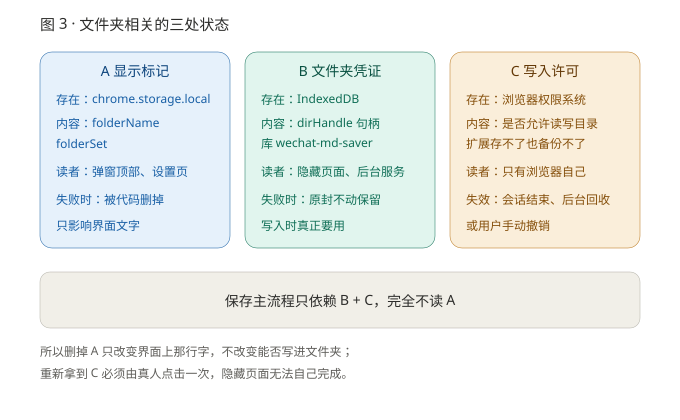
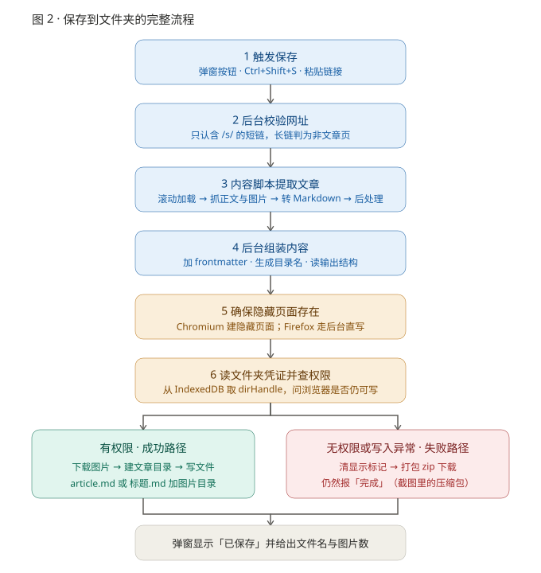
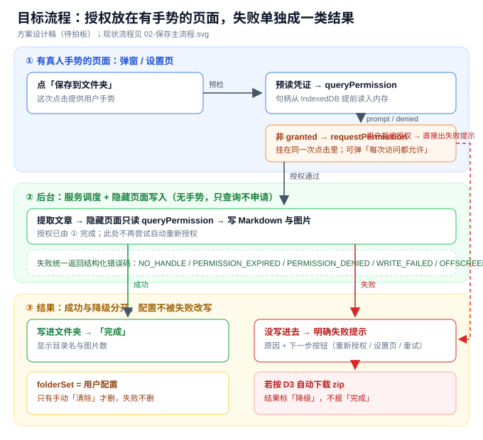
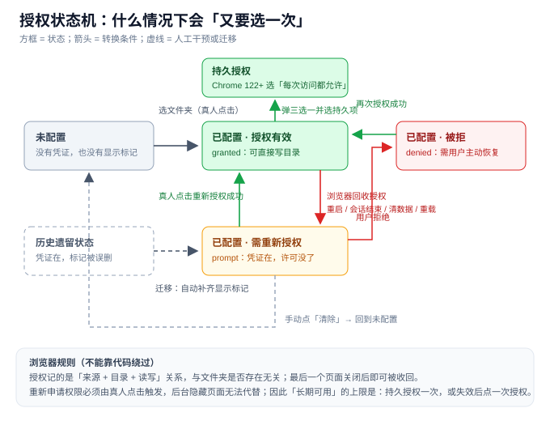

# 方案：保存到文件夹「一次配置、长期可用」＋ 失败可见

> 状态：**待拍板（决策 0 已选路线甲），未改动任何代码** ｜ 日期 2026-11-23 ｜ 代码基线 2.2.0
> 2026-11-23 21:28 更新：只读实测已完成（见 `docs/实测清单-S0只读检查.md` 第 7 节），用户已选定决策 0 的路线甲；第 6 节据此收敛了仍需拍板的条目。
> 现状基线：`docs/项目工作原理.md`（按当前代码如实梳理，含三张流程图）；本文第 1 节只摘与目标相关的部分。
> 缩写、代号、方案编号统一在**附录 A 术语表**与**附录 B 键表**定义；正文用短词。

---

## 0. 这份文档怎么用

- 本轮交付物只有：这份方案文档 + 两张目标流程图（`04-目标保存流程.svg`、`05-授权状态机.svg`）。
- **第 6 节是全量决策轴，需要一次性拍板**；拍板并给出明确口令后才进入实施，实施阶段划分见第 9 节。
- 现状文档保持为「改动前的基线」，不在本轮修改；实施完成后再单独更新（见 D9）。

---

## 1. 现状基线（工作原理摘要）

### 1.1 六个层次与三处状态

扩展分六层：入口（弹窗 / 快捷键 / 粘贴链接）→ 后台调度 → 内容层（抓网页转 Markdown）与文件层（隐藏页面写磁盘）→ 输出 → 状态。后台服务只调度，真正写文件的是隐藏页面。

与本次目标直接相关的，是「文件夹」这件事被拆成三处存放：

| 存的东西 | 位置 | 现在谁会删它 |
|---|---|---|
| 显示标记 `folderName` / `folderSet` | 扩展本地设置区 | **失败路径 6 处自动删**；设置页「清除」按钮手动删 |
| 文件夹凭证 `dirHandle` | IndexedDB，库 `wechat-md-saver` / 表 `handles` | 只有设置页「清除」按钮删 |
| 写入许可 | 浏览器自己的权限系统 | 浏览器按会话回收，扩展存不了也备份不了 |

### 1.2 保存主链路（压缩版）

1. 弹窗点「保存到文件夹」→ 建长连接发 `SAVE_ARTICLE`；快捷键由后台直接调同一个处理函数，且**端口为空**。
2. 后台校验网址 → 内容脚本提取文章（滚动触发懒加载、清 HTML、转 Markdown、收集图片清单）。
3. 后台组装 frontmatter 与安全文件名，准备写入上下文。
4. 创建隐藏页面并等就绪信号；不支持该接口的浏览器退回后台直写。
5. 隐藏页面从 IndexedDB 取凭证 → 查写入许可 → 下载图片 → 建目录 → 写文件。
6. 成功 → 报「完成」。
7. 失败（无凭证、许可被拒、写入异常）→ **删显示标记** → 打包下载 zip → **同样报「完成」**。

### 1.3 四条决定性事实

| 编号 | 事实 | 对目标的影响 |
|---|---|---|
| F1 | 保存主链路**完全不读** `folderSet`，只用凭证 + 写入许可 | 改界面文字不影响能否写入；配置消失只是显示问题 |
| F2 | 重新申请许可必须由真人点击触发；隐藏页面没有用户手势，现有自动重试是无效的 | 「失效后自动续期」这条路浏览器不允许，必须换触发位置 |
| F3 | 失败时 6 处删显示标记，但凭证仍在 | 界面误导为「未设置」，且准备好的「权限已过期」文案永远走不到 |
| F4 | `sendStatus` / `sendDone` 遇空端口直接 return；快捷键入口没有界面通道 | 快捷键保存失败时目前**零反馈**，方案必须单独设计这条通道 |

---

## 2. 目标与非目标（范围闭合）

### 2.1 目标

| 编号 | 目标 | 可验收的样子 |
|---|---|---|
| G1 | 选一次文件夹后长期可用，不用每次重新选 | 关闭浏览器再打开，直接点保存，文章写进原文件夹；**不出现系统目录选择框** |
| G2 | 写不进去时明确提示 | 界面明确说「没写进文件夹 + 原因 + 下一步怎么做」，不再静默下载 zip 后报「完成」 |
| G3 | 文件夹配置不因一次失败消失 | 失败后设置页仍显示已配置的文件夹名，只是标注「需重新授权」 |

**「不用每次都选」的准确定义，分两档**（浏览器规则决定上限，见第 8 节）：

- **强档**：一次持久授权后，重启浏览器、隔天再存都零交互。仅当 D2 选 A 且实测支持时成立。
- **保底档**：永不重开目录选择器；许可失效后最多点一次「重新授权」按钮，凭证继续复用。

必须说清楚：**代码无法做到「凭证在就永久自动续期」**。授权记的是「来源 + 目录 + 读写」关系，浏览器在最后一个页面关闭后可收回，与文件夹是否存在无关。若 D2 选 A 的条件不成立，交付承诺就是保底档，不是强档。

### 2.2 非目标（本次不做，需一并确认）

| 编号 | 不做的事 |
|---|---|
| N1 | 图片防盗链、图片下载失败率优化 |
| N2 | 长链 `/s?__biz=...` 网址判定修正 |
| N3 | `saveMode` 写了没人读、PDF 设置页文案与实现不符 |
| N4 | zip 内 Markdown 固定叫 `article.md`、Obsidian 模式降级时的路径差异 |
| N5 | zip 兜底二次下载图片的效率优化（除非 D1 勾选顺带修） |
| N6 | 两套文案来源（`i18n.js` 与 `_locales`）的全面统一 |
| N7 | 整体架构重构、多用户、云同步、数据库、登录、外部服务 |
| N8 | 新增自动提醒、定时任务、多设备同步 |
| N9 | Firefox 增加文件夹直写能力（该浏览器不支持文件系统访问接口） |
| N10 | 版本号、README、发布流程（除非 D10 勾选） |

---

## 3. 根因分层（为什么现在做不到）

| 层 | 问题 | 代码位置 | 为什么挡住目标 |
|---|---|---|---|
| P0 | 写入链路的前提未验证：三份清单都没声明 `offscreen`；等就绪信号的监听注册晚于创建文档；隐藏页面里调用了 `chrome.storage.local` | `manifest.json:7`、`service-worker.js:95-146`、`offscreen.js:92,215` | 若隐藏页面分支根本没启用，后面所有授权与写入改造都落空 |
| P1 | 许可失效不可自恢复 | `offscreen.js:42-51,243-267` | G1 做不到；自动申请因无手势抛异常后被吞掉 |
| P2 | 配置被当临时状态删 | `offscreen.js:237,249,261,265,298`、`service-worker.js:367-369` | G3 做不到；后台那层「权限被拒不清标记」的保护是死代码 |
| P3 | 结果与降级混为一谈 | `service-worker.js:371-375,579-602` | G2 做不到；失败原因那句进度文案会被「正在创建 zip」覆盖，最终报「完成」 |
| P4 | 快捷键入口没有反馈通道 | `service-worker.js:169,670-679` | 即使弹窗改好，快捷键失败仍然静默 |

---

## 4. 目标方案

### 4.0 四条设计原则

1. **配置与许可分离**：`folderSet` 只表示「用户配置过」，许可状态实时查询、不落库。
2. **授权与写入分离**：只在有真人手势的页面申请许可；后台与隐藏页面只查询、只写入。
3. **成功与降级分离**：只有真正写进目录才叫「完成」；zip 是另一类结果。
4. **失败原因不被进度覆盖**：最终结论放结果区，原因与下一步操作一起给全。

### 4.1 权限层：路径 A（持久授权，主）+ 路径 B（一键恢复，保底）

**路径 A — 一次持久授权**

- 触发位置：设置页新增「保持长期访问」按钮，或在「选择文件夹」的同一次点击链里追加一次申请动作（见 D11）。
- 动作：在有手势的页面对已有凭证调用 `requestPermission({mode:'readwrite'})`。Chrome 122+ 会弹三选一「仅此次允许 / 每次访问都允许 / 不允许」；用户选第二项即长期有效，可在站点设置里随时撤销。
- 效果：许可不再随会话结束掉回 `prompt`，达成 G1 强档。
- 前提与实测项：Chrome 文档主要针对网站与已安装的网页应用，**扩展页面能否弹三选一未实测**（R1）。若不支持，自动落回路径 B，并把强档从交付承诺中撤掉。

**路径 B — 一键重新授权（不重选目录）**

- 触发位置：弹窗点「保存到文件夹」这一次真人点击；以及设置页的「重新授权」按钮。
- 动作顺序：**弹窗打开时先把凭证从 IndexedDB 预读进内存**（避免异步读库耗尽用户手势）→ 点击时 `queryPermission` → 若不是 `granted`，在同一次点击里 `requestPermission` → 成功则继续后台写入；拒绝或异常则直接出失败提示。
- 关键点：**不调用 `showDirectoryPicker`**，不重开系统目录选择框；凭证一直复用。
- 需实测：在弹窗里授予的许可，隐藏页面查询时是否同样为 `granted`（同一扩展同源，理论共享，见 R2）。
- 隐藏页面里那段「无手势也能重新申请」的尝试**删除**，改为直接返回「需重新授权」错误码，把问题交回有手势的页面。

**两条路径合起来的用户体感**

| 情况 | 用户要做什么 |
|---|---|
| 首次使用 | 选一次文件夹（+ 若 D11 选「引导」则再点一次长期授权） |
| 路径 A 生效 | 之后什么都不用点 |
| 路径 A 不支持 / 许可被收回 | 弹窗点保存时弹一次授权确认，点「允许」即继续；**不用再选目录** |
| 用户拒绝授权 | 明确提示「未写入」，给出「重新授权」按钮 |

### 4.2 状态层：三态语义与历史迁移

| 界面状态 | 判定 | 显示 |
|---|---|---|
| 已配置 · 可用 | 显示标记在 + 凭证在 + 许可为 `granted` | 文件夹名（绿）+「已就绪」 |
| 已配置 · 需重新授权 | 显示标记在 + 凭证在 + 许可为 `prompt` / `denied` | 文件夹名（黄）+「需重新授权」+ 按钮 |
| 未配置 | 显示标记不在 | 「未选择」+「选择文件夹」 |

- `folderSet` 从此**只由用户手动「清除」删除**，任何失败路径都不删。
- 删除 6 处自动清除后，`service-worker.js:365-369` 那段保护注释与判断一并移除（不再需要）。
- 历史迁移（D7）：若凭证在、显示标记缺失（正是截图里的状态），启动时自动补写 `folderName` = 凭证名、`folderSet` = true，界面直接回到「已配置 · 需重新授权」。

### 4.3 写入层：前置修复 + 结构化结果

**前置修复（D1 决定是否纳入）**

1. 实测 `chrome.offscreen` 是否可用；若确实需要清单权限，给 `manifest.json` 与 `manifest.edge.json` 补声明（Firefox 清单不加，避免未知权限告警）。
2. 先注册就绪信号监听、再创建隐藏页面；用 `chrome.runtime.getContexts()` 判断是否已存在，消除竞态。
3. 隐藏页面不再直接读写 `chrome.storage.local`，需要的显示信息由后台经消息传入，规避该页面接口受限的隐患。

**结果统一**

隐藏页面与后台返回统一错误码（含义见附录 B）：`NO_HANDLE`、`PERMISSION_EXPIRED`、`PERMISSION_DENIED`、`WRITE_FAILED`、`OFFSCREEN_UNAVAILABLE`、`COMMUNICATION_ERROR`。后台按码分流，不再用「成功 / 失败」一个布尔量决定一切。

### 4.4 结果与提示层

| 结果 | 消息 | 界面 |
|---|---|---|
| 写进目录 | `DONE` | 「已保存：目录名（N 张图片）」 |
| 写不进目录 | 新增 `DEGRADED`（或 `ERROR` 带结构化载荷） | 「未写入文件夹」+ 原因 + 下一步按钮 |
| 自动降级 zip（若 D3 选自动） | `DEGRADED` | 「已下载 zip（降级），原文件夹未写入」+ 原因 + 按钮；**绝不显示「完成」** |

- 四类原因文案对应四类动作：未配置 → 去设置页选文件夹；需重新授权 → 点「重新授权」；被拒 → 去设置页恢复；写入/链路异常 → 「重试」+ 展开技术细节。
- 失败原因写进**结果区**，不再只发一条会被后续进度覆盖的状态文案。
- 弹窗结果区增加可点按钮（「重新授权」「打开设置页」「重试」），按钮行为由 D3 / D11 决定。
- **快捷键 / 无界面入口**：因为端口为空，按 D4 选角标、通知或自动打开设置页，保证 P4 不再静默。

### 4.5 两张目标图

### 4.6 三种场景走一遍

| 场景 | 流程 |
|---|---|
| 许可有效 | 点保存 → 预检 `granted` → 后台提取 → 隐藏页面写入 → 「完成」 |
| 许可失效 | 点保存 → 预检 `prompt` → 同一次点击申请授权 → 弹窗确认「允许」→ 后台写入 → 「完成」（全程没开目录选择框） |
| 用户拒绝 / 写入异常 | 点保存 → 授权被拒或写入报错 → 结构化错误码 → 结果区说明「未写入文件夹」+ 原因 + 下一步；按 D3 决定是否附带 zip |

---

## 5. 改动清单（文件级，拍板后才动）

| 文件 | 改什么 | 关联决策 | 主要风险 |
|---|---|---|---|
| `manifest.json`、`manifest.edge.json` | 补 `offscreen` 权限声明（路线甲已定）；若 D4 选通知则加 `notifications` | 决策 0、D1、D4、D5 | Firefox 清单不能加未支持的权限 |
| `background/service-worker.js` | 就绪竞态、错误码分流、删自动清标记、`sendDone` 只在成功时、zip 结果语义、快捷键反馈 | D1、D3、D4 | 端口为空的路径要单独测 |
| `offscreen/offscreen.js` | 删 5 处清标记、删无效自动申请、移除 `chrome.storage.local` 依赖、返回结构化错误 | D1、D8 | 隐藏页面与后台的消息契约要同步改 |
| `popup/popup.js` / `popup.html` / `popup.css` | 预读凭证、点击链里预检与申请、结果区按钮、三态显示 | D2、D4、D6、D11 | 用户手势是否在异步链路中仍有效（R3） |
| `options/options.js` / `options.html` / `options.css` | 「保持长期访问 / 重新授权」按钮、三态显示、历史迁移、只由「清除」删配置 | D7、D11、D6 | 迁移不能把「用户真的清除过」的状态又补回来 |
| `shared/i18n.js` + `_locales/en/messages.json` + `_locales/zh_CN/messages.json` | 新增失败原因、降级、按钮文案 | D6 | 两套文案来源要同时改，避免又不一致 |
| `shared/folder-permission.js`（拟新增） | 统一封装读凭证、查许可、申请许可 | D8 | `build.ps1:29` 的白名单已含 `shared`，新增文件可进包 |
| `docs/使用说明.md` + `help/help.html` | 同步「授权会失效、如何一键恢复、失败时会明确提示」 | D9 | 帮助页与文档正文需保持同源 |
| `docs/项目工作原理.md` | **本轮不动**；实施后按新代码更新 | D9 | 保持改动前基线可追溯 |

---

## 6. 决策轴（开工前一次性拍板）

> 每一条都需要明确选择；**没有「按推荐默认执行」这一说**，未拍板即视为未确认，不会开工。
> 只读实测后的收敛结果见 6.1；6.2 是仍需逐条选择的完整清单。

### 6.1 已经收敛、不用再选的部分

| 项 | 结论 | 来源 |
|---|---|---|
| 决策 0（写入主体路线） | **路线甲：补 `offscreen` 权限声明、启用隐藏页面，写入仍由隐藏页面完成** | 用户 21:28 拍板 |
| 决策 1（改造范围）中的前置修复 | **必须做**：实测 `chrome.offscreen = undefined`、隐藏页面没被创建，v2.2.0 那套修复从未生效 | 实测清单第 7.2 节 |
| 决策 2（长期可用路径）中的「改用下载目录」 | **排除**：与路线甲和「自选文件夹」的产品语义冲突 | 路线甲已选 |

### 6.2 仍需拍板的决策（12 条）

| 编号 | 决策事项 | 选项 | 推荐 | 实测后的变化 |
|---|---|---|---|---|
| D1 | 改造范围 | ① 权限层 + 提示层 + 前置修复；② 再加 zip 二次下载图片优化；③ 再加 `verifyHandleUsable()` 试写逻辑简化 | ① | 原②（前置修复）已并入①；实测证明许可查询可用，试写逻辑可考虑删 |
| D2 | 长期可用路径 | A+B：持久授权优先、一键恢复兜底（需先补测三选一）；仅 B：只做一键恢复，交付承诺为保底档 | 仅 B | 原 C 已排除；三选一未实测，A 不能写进交付承诺 |
| D3 | 写失败时是否仍自动下载 zip | ① 自动下载但标「降级」；② 不下载，只提示；③ 弹确认由用户选 | ① | — |
| D4 | 快捷键 / 无界面入口的失败提示 | ① 浏览器通知（需新权限）；② 角标 + 自动打开设置页；③ 仅角标；④ 不改 | ② | ④ 会让无界面入口继续静默 |
| D5 | 浏览器范围 | ① Chrome + Edge；② 仅 Edge（实测环境）；③ 仅 Chrome；④ 三端含 Firefox（Firefox 仍只下载 zip） | ① | 实测用的是 Edge 156；选「仅 Chrome」会导致你装不上 |
| D6 | 新增文案 | ① 中英双语（两处文案来源同步）；② 仅中文 | ① | 实测设置页语言为 English，只做中文会中英混杂 |
| D7 | 历史误删标记 | ① 自动补齐（凭证在、标记缺失）；② 只保证以后不删 | ① | 实测这台机器标记还在，①不再紧迫，但仍建议作为自愈能力 |
| D8 | 是否新增共享模块 | ① 抽 `shared/folder-permission.js`；② 各页面各写一份 | ① | 路线甲下三处都要读凭证查许可，重复易漂移 |
| D9 | 文档同步 | ① 使用说明 + 帮助页同步改，现状原理文档实施后再更新；② 只改代码；③ 全部文档一起改 | ① | — |
| D10 | 产物与提交 | ① 重新打三端包 + 提交 git + 升版本号；② 重新打包但不提交；③ 只改源码 | 待你定 | 涉及 `build.ps1` 与提交习惯 |
| D11 | 持久授权的引导方式 | ① 设置页独立「保持长期访问」按钮；② 选完文件夹后同一次点击链自动触发；③ 不引导，只在失效时提示 | ①（若 D2 选仅 B 则选③） | 三选一能否弹出未测，②可能不弹（R4） |
| D12 | 用户拒绝授权后 | ① 保留本次文章内容，允许点「重新授权」后直接重试；② 丢弃，重新点保存 | ① | 影响是否要在弹窗内缓存文章数据 |

**本次不做（范围闭合，需一并确认）**：沿用第 2.2 节 N1–N10；另外不做路线乙（后台服务直写）、不做 Firefox 文件夹直写。

> 以上 12 条全部选定并给出明确口令后才进入实施；只给部分答案不动工。

### 6.3 拍板进度（持续更新）

| 时间 | 已拍板 | 确认内容 |
|---|---|---|
| 2026-11-23 21:31 | D10（产物与提交）= ① | 重新打三端包 + 提交 git + 升版本号；接受提交与版本变更 |
| 2026-11-23 21:31 | D11（持久授权引导）= ③ | 不设独立引导按钮，只在许可失效时提示一键重新授权 |

> **D11 选③的连带影响，需与 D2 一并确认**：不主动引导「每次访问都允许」，等于放弃 G1 强档（重启后零交互）。因此 D2 应选「仅 B：只做一键恢复」，不应再选「A+B：持久授权优先」。此处不替用户改 D2，留待其确认。

### 6.4 口令与完整决策集（2026-11-23 21:35）

用户口令：**「按推荐值干」**。经确认，完整决策集如下，实施按此执行：

| 决策 | 选定 | 含义 |
|---|---|---|
| 决策 0（写入主体路线） | 甲 | 补 `offscreen` 权限声明、启用隐藏页面，写入仍由隐藏页面完成 |
| D1（改造范围） | ① | 权限层 + 提示层 + 前置修复；**不做** zip 二次下载优化、不做试写逻辑简化 |
| D2（长期可用路径） | ② | 只做一键恢复，交付承诺为保底档；**不做**持久授权引导（与 D11=③ 一致） |
| D3（失败时 zip） | ① | 自动下载但标「降级」，绝不报「完成」 |
| D4（快捷键提示） | ② | 角标 + 自动打开设置页；不加通知权限 |
| D5（浏览器范围） | ① | Chrome + Edge；Firefox 仅把「完成」改成明确降级 |
| D6（文案语言） | ① | 中英双语，`i18n.js` 与两份 `_locales` 同步 |
| D7（历史误删标记） | ① | 凭证在、标记缺失时自动补齐 |
| D8（共享模块） | ① | 新增 `shared/folder-permission.js`，三处共用 |
| D9（文档同步） | ① | 使用说明 + 帮助页同步改，工作原理文档实施后再更新 |
| D10（产物与提交） | ① | 重新打三端包 + git 提交 + 升版本号 |
| D11（持久授权引导） | ③ | 不引导，只在许可失效时提示一键重新授权 |
| D12（拒绝授权后） | ① | 保留本次文章，点「重新授权」后直接重试 |

> 范围闭合：第 2.2 节 N1–N10 仍为本次非目标；另不做路线乙、不做 Firefox 文件夹直写、不做 G1 强档（持久授权）。

---

## 7. 验收口径

### 7.1 分场景验收（拍板后按此逐条给证据）

| 场景 | 操作 | 期望结果 | 证据 |
|---|---|---|---|
| 正常保存 | 点「保存到文件夹」 | 磁盘出现文章目录与图片，弹窗「完成」 | 目录截图 + 弹窗截图 |
| 重启后（路径 A 生效） | 完全关闭浏览器再打开，直接保存 | 写进原文件夹，无任何授权弹窗、无目录选择框 | 录屏或前后截图 + 控制台许可值 |
| 重启后（路径 A 不支持） | 同上 | 最多弹一次授权确认，点「允许」后写入；**不出现目录选择框** | 授权弹窗截图 + 目录截图 |
| 用户拒绝授权 | 在授权弹窗点「不允许」 | 明确「未写入文件夹」+ 原因 + 「重新授权」按钮；按 D3 决定有无 zip | 弹窗截图 |
| 写入异常 | 人为让目标目录不可写 | 明确失败原因，配置仍显示已选文件夹 | 设置页截图 + 控制台错误码 |
| 配置不丢 | 任意失败后再打开设置页 | 仍显示文件夹名，状态为「需重新授权」或「已就绪」 | 设置页截图 |
| 历史状态自愈 | 用现有被误删标记的配置启动 | 自动补齐显示标记 | 设置页截图 + 控制台存储值 |
| 快捷键入口 | 在文章页按 `Ctrl+Shift+S` 且许可失效 | 按 D4 给出可见提示，不静默 | 角标/通知/设置页截图 |
| 三端打包 | 执行 `build.ps1` | 三份产物含新增文件，manifest 引用路径都存在 | 打包输出 + 解压核对 |

### 7.2 实测前提

- 当前环境**无法装载扩展到真实浏览器**，授权弹窗、许可跨页面共享、重启行为都必须在用户的 Chrome / Edge 里实测；这些是 R1、R2、R3 的判定依据，不能靠静态分析下结论。
- **S0 只读实测已于 2026-11-23 完成**，结果见 `docs/实测清单-S0只读检查.md` 第 7 节：`chrome.offscreen` 不存在、隐藏页面从未创建，P0 已坐实；许可查询可用且当前为 `granted`。R1（三选一）与 R3（异步读库后手势）仍未测，因此交付承诺按保底档写，除非补测通过。

### 7.3 本轮（方案阶段）的完成标准

- 现状工作原理已在 `docs/项目工作原理.md` 落盘，本方案文档自带现状摘要与两张目标图；
- 决策轴全量列出、范围闭合；
- **用户确认方案 + 给出明确口令**之前，不修改任何源码、清单、文案或构建产物。

---

## 8. 风险与不确定性

| 编号 | 风险 | 验证方法 | 若不成立的退路 |
|---|---|---|---|
| R1 | 扩展页面能否弹出「每次访问都允许」三选一，Chrome 文档未明确 | 在设置页真人点击调用 `requestPermission()` 观察弹窗 | 撤掉 G1 强档，交付保底档（路径 B） |
| R2 | 弹窗里授予的许可，隐藏页面查询是否同为 `granted` | 授权后分别在弹窗与隐藏页面控制台查 `queryPermission()` | 把授权动作改到设置页，写入前由后台再次核验；仍不共享则需重新评估架构 |
| R3 | 用户手势在异步读库后是否仍有效 | 点击链里实际调用一次并看是否抛 `SecurityError` | 弹窗打开时预读凭证进内存，点击时同步发起申请 |
| R4 | 刚选完文件夹就申请许可，可能不弹三选一 | 实测 D11 的两种触发方式 | 改为独立按钮，间隔一次点击再触发 |
| R5 | `offscreen` 权限是否真的必需，以及隐藏页面能否用 `chrome.storage.local` | 扩展详情页权限列表 + 控制台 `typeof chrome.offscreen` | 按实测结果决定补不补权限；隐藏页面存储依赖一律移除 |
| R6 | 用户预期被改变：以前「完成」其实常是 zip，改后会出现明确的失败提示 | 验收时对照第 7.1 节逐条确认 | 通过 D3 选择降级行为，文案写清「已下载 zip，但未写入文件夹」 |

---

## 9. 实施阶段划分（拍板并给出口令后）

| 阶段 | 内容 | 阶段产物 |
|---|---|---|
| S0 | 只读实测：权限列表、`chrome.offscreen`、许可跨页面共享、三选一是否可弹 | **已完成**：权限缺失坐实，R1 / R3 待补测，见实测清单第 7 节 |
| S1 | 状态层与结果层：删自动清标记、三态显示、结构化错误码、失败提示与快捷键反馈 | 可验证「配置不丢 + 失败可见」 |
| S2 | 权限层：预读凭证、点击链申请许可、持久授权引导、隐藏页面去掉无效申请 | 可验证「不重选目录」 |
| S3 | 前置修复、文案双语、文档与帮助页同步 | 完整功能闭环 |
| S4 | 三端打包、按第 7.1 节逐条验收、更新现状原理文档 | 验收证据 + 交付物 |

> 每个阶段结束先落盘文档，再讨论下一步；不跨阶段抢跑。

---

## 附录 A 术语表

| 词 | 含义 |
|---|---|
| Manifest V3（MV3） | Chrome 扩展第三代清单规范，后台为会被回收的后台服务 |
| service worker（SW，后台服务） | 无 DOM 的后台脚本，本项目里只做调度 |
| offscreen document（隐藏页面） | 扩展的不可见 DOM 页面，本项目用它真正写文件 |
| popup（弹窗） | 点扩展图标弹出的小窗口，点击可产生用户手势 |
| options page（设置页） | 扩展的设置界面，同样是可扩展页面、可产生用户手势 |
| File System Access API（文件系统访问接口） | 浏览器提供的本地目录读写能力 |
| dirHandle（文件夹凭证／句柄） | 代表用户所选目录的可序列化对象，存在 IndexedDB |
| IndexedDB（浏览器本地数据库） | 浏览器自带的键值数据库，本项目用它存文件夹凭证 |
| chrome.storage.local（扩展本地设置区） | 扩展自己的小设置存储，与网页缓存、localStorage 都不同 |
| queryPermission / requestPermission | 查询当前许可 / 重新申请许可；后者必须由真人点击触发 |
| 用户手势（transient activation） | 真人点击后浏览器短暂授予的许可，后台脚本无法伪造 |
| 持久授权 | Chrome 122+ 三选一里「每次访问都允许」，选后许可长期有效、可随时撤销 |
| 一键重新授权 | 用已有凭证、在真人点击里重新申请许可，不重开目录选择框 |
| 降级结果 | 没写进目标文件夹、改为下载 zip 的结果，不等于「完成」 |
| zip fallback（压缩包兜底） | 写不进文件夹时打包下载 zip 的备用路径 |
| frontmatter | Markdown 文件开头用 `---` 包起来的元信息块 |
| outputStructure（输出结构） | `simple`（images/ 并列）或 `obsidian`（assets/标题/ 嵌套） |
| 端口（port） | 弹窗与后台之间的长连接 `save-article`；快捷键路径没有端口 |
| 决策 0（D0） | 写入主体路线：隐藏页面（甲）／后台服务直写（乙）；已选甲 |
| P0–P4、F1–F4、G1–G3、N1–N10、D0–D12、R1–R6、S0–S4 | 本文内部编号：根因层、现状事实、目标、非目标、决策轴、风险、实施阶段 |

---

## 附录 B 拟新增 / 变更的键与代号

**统一错误码（后台与隐藏页面之间）**

| 代号 | 含义 | 界面动作 |
|---|---|---|
| `NO_HANDLE` | 没有文件夹凭证 | 去设置页选文件夹 |
| `PERMISSION_EXPIRED` | 凭证在，许可掉回 `prompt` | 点「重新授权」 |
| `PERMISSION_DENIED` | 许可被拒 | 去设置页恢复授权 |
| `WRITE_FAILED` | 写文件过程报错且重试仍失败 | 「重试」+ 展开细节 |
| `OFFSCREEN_UNAVAILABLE` | 隐藏页面未启用或创建失败 | 「重试」+ 提示重载扩展 |
| `COMMUNICATION_ERROR` | 后台与隐藏页面通信失败 | 「重试」 |

**消息（长连接端口）**：沿用 `DONE`、`ERROR`；拟新增 `DEGRADED`（带 `code`、`reason`、`nextAction` 字段）。

**本地设置键**：`folderName`、`folderSet` 语义改为「用户配置」，不新增持久化许可字段；许可状态实时查询、不落库。

**拟新增文案键**：失败标题、四类原因、降级说明、「重新授权」「打开设置页」「重试」按钮、设置页三态提示、持久授权引导语（中英各一套，落在 `i18n.js` 与两份 `_locales`）。
