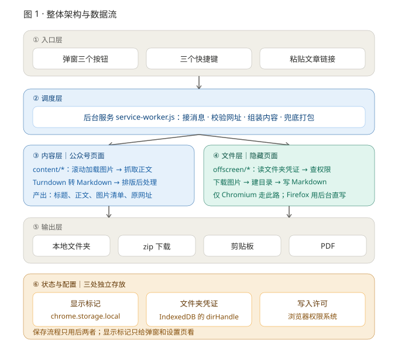
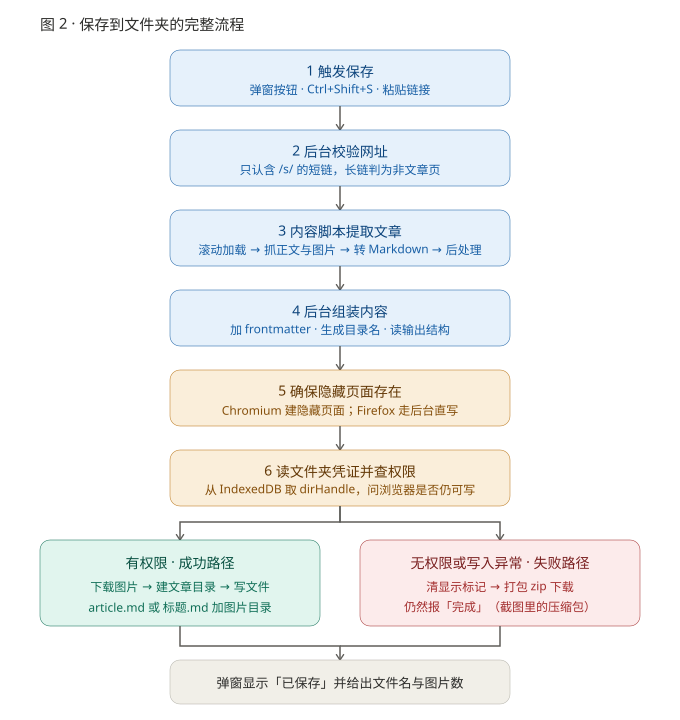
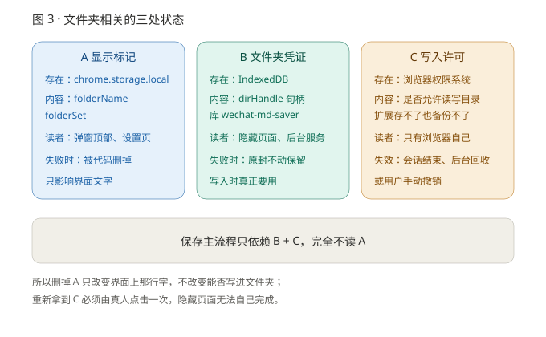

# 项目工作原理（按当前代码如实梳理）

> 版本 2.3.0 ｜ 初版梳理 2026-11-23（基于 2.2.0）｜ 2026-11-23 按 v2.3.0 实施结果更新。本文只描述**现在怎么跑**，不含修改建议。
> 2.2.0 的改动前基线见 `docs/方案-免重选文件夹与失败可见.md` 第 1 节；v2.3.0 改了什么见 `docs/实施记录-v2.3.0.md`。
> 缩写与代号统一在**附录 A 术语表**里定义；消息名和存储键在**附录 B**。

---

## 0. 一句话定位

这是一个浏览器扩展：把微信公众号文章抓成 Markdown，连同图片一起写进用户指定的本地文件夹；**写不进去时降级成 zip 下载**。另有「复制到剪贴板」「保存为 PDF」两条旁路，以及弹窗里粘贴文章链接后自动保存的入口。

---

## 1. 目录与职责

| 路径 | 职责 | 备注 |
|---|---|---|
| `manifest.json` / `manifest.edge.json` / `manifest.firefox.json` | 三份扩展清单 | 权限、快捷键、内容脚本、后台入口都在里头；Edge 版与 Chrome 版内容相同 |
| `background/service-worker.js` | 后台总调度 | 接消息、校验网址、组装内容、转发进度、失败时打包 zip、生成 PDF |
| `offscreen/offscreen.html` + `offscreen.js` | 隐藏页面，真正写文件 | 读文件夹凭证、查权限、下载图片、建目录、写 Markdown 与图片 |
| `content/extractor.js` | 从公众号页面抓正文 | 提标题/作者/日期、清理 HTML、收集图片清单、滚动触发懒加载 |
| `content/content-script.js` | 内容脚本入口 | 接收 `EXTRACT`、复制剪贴板、打印兜底、页面内提示条 |
| `content/turndown-config.js` / `post-processor.js` | HTML 转 Markdown 与排版后处理 | 中英文空格、空行规整、标题层级修正 |
| `popup/` | 扩展弹窗 | 三个按钮、文件夹状态行、粘贴链接输入、进度与结果 |
| `options/` | 设置页 | 选/清文件夹、输出结构、重复保存开关、界面语言、默认保存模式 |
| `help/` | 扩展内帮助页 | 固定中文，与 `docs/使用说明.md` 同源 |
| `shared/browser.js` | 跨浏览器兼容层 | 判定 Chrome / Edge / Firefox，统一 debugger 与 badge 接口 |
| `shared/i18n.js` + `_locales/` | 两套文案来源 | 界面实际以 `i18n.js` 内置表为准 |
| `shared/saved-index.js` | 重复保存检测 | 规范化原链接、读写文件夹内清单、首次扫描补录；后台与隐藏页面共用 |
| `lib/turndown.min.js` / `jszip.min.js` | 两个第三方库 | 转 Markdown、打包 zip |
| `build.ps1` / `build.bat` / `build.sh` | 打包三端产物 | 输出到 `dist/chrome`、`dist/edge`、`dist/firefox` 及三个 zip |

---

## 2. 三种入口

| 入口 | 触发方式 | 去向 |
|---|---|---|
| 弹窗三个按钮 | 点「保存到文件夹」「复制到剪贴板」「保存为 PDF」 | 保存/PDF 走后台长连接端口 `save-article`；复制直接在弹窗里完成 |
| 快捷键 | `Ctrl+Shift+S` / `Ctrl+Shift+C` / `Ctrl+Shift+P` | 后台 `chrome.commands` 监听，直接调对应处理函数 |
| 粘贴链接 | 弹窗输入公众号链接 → 开一个后台标签页 → 等加载完成 | 抓取该标签页内容，再走同一条保存链路；结束后关掉标签页 |

三条入口最终都要求当前网址里含 `mp.weixin.qq.com/s/`，否则判为「不是公众号文章」并禁用按钮。

---

## 3. 整体架构

从上往下看是六层：**入口 → 后台调度 → 内容层与文件层 → 输出 → 状态**。

- **内容层**跑在公众号页面里，负责「把网页变成 Markdown 和图片清单」；
- **文件层**跑在扩展的隐藏页面里，负责「把这些内容真的写进磁盘」；
- **后台服务**只做调度，不碰 DOM，也不长期保存东西（浏览器空闲时会把它回收）；
- **状态层三处独立存放**，是理解当前故障的关键，见第 6 节。

---

## 4. 主链路：保存到文件夹

逐步展开：

1. **触发与预授权**：弹窗打开时由 `shared/folder-permission.js` 预读 `dirHandle` 进内存。点「保存到文件夹」时，若当前许可不是 `granted`，先在这一次点击里 `requestPermission()`（保住用户手势、不重开目录框）；被拒则直接提示并停止。之后才用 `chrome.runtime.connect({name:'save-article'})` 发 `SAVE_ARTICLE`（可带 `tabId`）。快捷键没有界面手势，跳过预授权、由后台处理失败。
2. **校验网址**：`resolveTabId()` 检查网址里是否含 `/s/`。
3. **提取文章**：后台发 `EXTRACT` 给内容脚本 → 先滚动页面触发微信图片懒加载 → `extractArticle()` 抓标题、作者、日期、`#js_content` 正文 → 清掉隐藏元素、把 `data-src` 换成 `src`、去掉追踪图片与脚本 → 用 Turndown 转成 Markdown → `postProcessMarkdown()` 做中英文空格、空行、标题层级修正 → 收集去重后的图片清单（`img-001.jpg` 这类文件名）→ 返回 `{title, author, publishDate, markdown, contentHtml, images, sourceUrl}`。
4. **组装**：后台加一段 frontmatter（标题、作者、日期、原链接、保存时间），生成安全文件名 `safeTitle` 和文章目录名 `safeDirName`（标题 + 时间戳），再读设置里的 `outputStructure` 与 `overwriteExisting`（覆盖开关），一并放进写入载荷。
5. **准备写入上下文**：`ensureOffscreenDocument()` 在 Chromium 上用 `getContexts()` 判断是否已有隐藏页面，没有则创建（`reasons: ['BLOBS']`）；先注册 `OFFSCREEN_READY` 监听再创建，避免漏接就绪信号。Firefox 没有该接口，退回「后台服务直接写」。
6. **查权限并判重**：隐藏页面经共享模块从 IndexedDB 取 `dirHandle`，只 `queryPermission()` 查许可、**不在这里申请**（无用户手势）。许可通过后先用 `shared/saved-index.js` 读文件夹根目录的 `.wechat-md-saver.json`；清单不存在时扫描已有文章目录补录（第一次使用会自动认出旧版本保存的文章）。按规范化原链接查重，**在下载任何图片之前**完成。权限不是 `granted` 时返回结构化错误码 `PERMISSION_EXPIRED` / `PERMISSION_DENIED`，交回弹窗处理。
7. **查权限并写入**：命中重复且开关为「跳过」→ 返回 `{duplicate:true}`，不下载、不写文件、不打包 zip；命中重复且开关为「覆盖」→ 沿用旧文章目录名，其余按当前配置；未命中 → 用新目录名。然后 `writeArticle()` 并发下载图片（并发 3、单张超时 15 秒、最多重试 2 次），按输出结构建目录并写文件。**只有写入成功后**才把这篇文章记进清单。
8. **三条出口**：
   - 重复跳过 → 后台 `sendAlreadySaved()` → 弹窗显示「已保存过 — 未重复写入」；快捷键无弹窗时显示绿色角标「已」；不报失败、不降级 zip；
   - 成功 → 后台 `sendDone()` → 弹窗显示「已保存：目录名（N 张图片）」；
   - 失败 → **不清除任何配置** → 后台 `handleZipFallback()` 用 JSZip 打包 → 下载 `标题.zip` → 发一条 `degraded` 结果（附带原因码、下一步提示、zip 文件名），**不报「完成」**。弹窗显示「未写入文件夹 + 原因 + 下一步」并给「重新授权 / 重试」按钮；快捷键无弹窗时显示红色角标并自动打开设置页。

### 4.1 写进文件夹时的目录结构

| 输出结构 | 目录形态 |
|---|---|
| `simple`（默认） | `标题_时间戳/article.md` + `标题_时间戳/images/` |
| `obsidian` | `标题_时间戳/标题.md` + `标题_时间戳/assets/标题/` |

### 4.2 zip 降级时的目录形态

压缩包里固定是 `article.md` + `images/`（或 `assets/标题/`），**即使选了 Obsidian 模式，Markdown 文件仍叫 `article.md`**。

### 4.3 进度怎么回传

隐藏页面通过 `WRITE_PROGRESS` 广播进度，后台收到后转成文案，经长连接端口推给弹窗。这条广播与结果消息是两条独立的路。

---

## 5. 另外两条链路

### 5.1 复制到剪贴板

弹窗自己发 `EXTRACT` 给内容脚本 → 拼 frontmatter → 发 `COPY_TO_CLIPBOARD` → 内容脚本先试 `navigator.clipboard.writeText()`，失败则退回隐藏输入框 + `document.execCommand('copy')`，并在页面上弹一条 2 秒提示。快捷键路径由后台 `handleCopyToClipboard()` 走同一套。图片保留远程链接，不下载。

### 5.2 保存为 PDF

后台 `generateAndSavePdf()` → 取 `contentHtml` → 拼一个带打印样式的完整 HTML → 开一个隐藏标签页用 `data:text/html` 加载 → 等加载完成再等 1.5 秒 → 用调试器接口 `Page.printToPDF` 静默生成 PDF → 尝试通过 `WRITE_PDF` 写进已选文件夹 → 写不进去则 `chrome.downloads.download` 下载 → 关掉临时标签页。整条链路失败时才回退到「打开打印对话框」。设置页里写的「触发保存为 PDF」与实际实现不一致。

---

## 6. 数据存在哪里

| 存的东西 | 位置 | 谁写 | 谁读 |
|---|---|---|---|
| `folderName` / `folderSet` | `chrome.storage.local` | 设置页选文件夹写入、点「清除」删除；**失败路径不再删除**；凭证在但标记缺失时启动自动补回 | 弹窗顶部、设置页（**仅显示用**） |
| `outputStructure` / `uiLanguage` / `saveMode` / `overwriteExisting` | `chrome.storage.local` | 设置页 | `outputStructure`、`overwriteExisting` 会被读；`saveMode` 目前**写了没人读** |
| `dirHandle`（文件夹凭证） | IndexedDB，库 `wechat-md-saver`，表 `handles`，键 `dirHandle` | 设置页 `showDirectoryPicker()` 拿到后写入，并回读校验一次 | 隐藏页面、后台服务 |
| 写入许可 | 浏览器自己的权限系统 | 用户在授权弹窗里点「允许」 | 只有浏览器；扩展既存不了也备份不了 |
| 已保存文章清单 | 所选文件夹根目录 `.wechat-md-saver.json` | 隐藏页面（Firefox 为后台服务）：首次扫描补录 + 每次写入成功后更新 | 隐藏页面在下载图片前查重 |

清单文件随文件夹走：复制或同步这个文件夹，记录也一起带走。它不存 `dirHandle`，也不碰写入许可，那两样仍按上表第 3、4 行各自的路径存放。

**最要紧的一点**：保存主流程只用「文件夹凭证 + 写入许可」，**完全不读 `folderSet`**。所以显示标记被删，只影响弹窗和设置页上那行字，不影响能不能写入；反过来，写入许可失效时，界面上仍会显示已选文件夹名。

---

## 7. 跨浏览器差异

| | Chrome / Edge | Firefox |
|---|---|---|
| 后台形态 | service worker（会被回收）+ 隐藏页面写文件 | 后台脚本直接写文件 |
| 选文件夹 | 支持 | 不支持，设置页按钮置灰 |
| 保存结果 | 成功写目录；失败下载 zip | 始终下载 zip |
| 清单差异 | 两份清单内容相同 | 多 `browser_specific_settings`，用 `options_ui` 而非 `options_page` |

`shared/browser.js` 通过全局对象与 UA 判定浏览器，并统一 `debugger` 与角标接口的调用形式。

---

## 8. 薄弱环节：v2.2.0 已修复项与仍存在项（只陈述现状）

### 8.1 v2.3.0 已修复（原第 1–5 条）

1. ~~清单缺 `offscreen` 权限、隐藏页面从未创建~~ → Chrome/Edge 清单已补该权限，隐藏页面首次真正启用；就绪信号竞态同时修复。
2. ~~权限失效只能在设置页重选文件夹~~ → 改为在弹窗点击与设置页按钮的真人手势里一键重新授权，复用凭证、不重开目录框。
3. ~~失败路径 6 处删显示标记~~ → 全部移除，配置不再被临时失败抹掉；凭证在、标记缺失时启动自动补回。
4. ~~「权限被拒不清标记」保护不生效~~ → 保护逻辑整体删除，不再需要。
5. ~~zip 兜底报「完成」~~ → 改为 `degraded` 结果，明确「未写入 + 原因 + 下一步」，失败不再伪装成功。

### 8.2 仍存在（本次非目标，范围闭合）

1. zip 兜底没有复用已下载的图片数据，会再下载一轮（D1 明确不做此优化）。
2. 默认保存模式 `saveMode` 只写不读；网址判定只认 `/s/` 短链；zip 里 Markdown 固定叫 `article.md`。以上在 `docs/使用说明.md` 第九节作为已知偏差列出。
3. 两套文案来源仍有少量历史差异；2.3.0 新增文案已两处同步。
4. 弹窗授权的许可与隐藏页面查询是否处处一致（风险 R2）仍待真实浏览器实测，见 `docs/实施记录-v2.3.0.md` 第 5 节。

---

## 附录 A 术语表

| 词 | 含义 |
|---|---|
| Manifest V3（MV3） | Chrome 扩展第三代清单规范；后台改为 service worker，空闲会被回收 |
| service worker（SW，后台服务） | 无 DOM 的后台脚本，负责调度，不能弹界面 |
| offscreen document（隐藏页面） | 扩展能长期保留的一个不可见 DOM 页面，用来做需要页面上下文的操作 |
| content script（内容脚本） | 注入到公众号网页里运行的脚本，能读页面 DOM |
| popup（弹窗） | 点扩展图标弹出的小窗口 |
| options page（设置页） | 扩展的设置界面 |
| File System Access API（文件系统访问接口） | 浏览器提供的本地目录读写能力，`showDirectoryPicker()` 由用户选目录 |
| dirHandle（文件夹凭证／句柄） | 代表用户所选目录的可序列化对象，存进 IndexedDB |
| queryPermission / requestPermission | 查询当前权限 / 重新申请权限；后者必须由真人点击触发 |
| IndexedDB（浏览器本地数据库） | 浏览器自带的键值数据库，本项目用它存文件夹凭证 |
| chrome.storage.local（扩展本地设置区） | 扩展自己的小设置存储，与网页缓存、网页 localStorage 都不同 |
| Turndown | 把 HTML 转成 Markdown 的第三方库 |
| JSZip | 在浏览器里打包 zip 的第三方库 |
| frontmatter | Markdown 文件开头用 `---` 包起来的元信息块 |
| outputStructure（输出结构） | `simple`（images/ 并列）或 `obsidian`（assets/标题/ 嵌套） |
| overwriteExisting（重复保存开关） | `true` = 命中重复时覆盖；`false`（默认）= 跳过 |
| saved-index（已保存清单） | 所选文件夹内的 `.wechat-md-saver.json`，按规范化原链接记录已成功保存的文章 |
| 规范化原链接 | 原网址去掉追踪参数、哈希、结尾斜杠并统一主机大小写后的形式，用作判重依据 |
| safeTitle / safeDirName | 去掉非法字符后的文件名 / 文章目录名 |
| zip fallback（压缩包兜底） | 写不进文件夹时，打包下载 zip 的备用路径 |
| 用户手势（transient activation） | 真人点击按钮后浏览器短暂授予的许可，无法由后台脚本伪造 |
| debugger / Page.printToPDF | 调试器接口及其生成 PDF 的命令，本项目用它静默出 PDF |

---

## 附录 B 消息与存储键速查

**消息（动作名）**：`SAVE_ARTICLE`、`SAVE_PDF`、`EXTRACT`、`COPY_TO_CLIPBOARD`、`PRINT_PDF_FALLBACK`、`WRITE_ARTICLE`、`WRITE_PDF`、`WRITE_PROGRESS`、`RELOAD_HANDLE`、`CHECK_HANDLE`、`PING`、`OFFSCREEN_READY`、`OFFSCREEN_HEARTBEAT`。

**本地设置键**：`folderName`、`folderSet`、`outputStructure`、`saveMode`、`uiLanguage`、`overwriteExisting`。

**数据库**：`wechat-md-saver` / 表 `handles` / 键 `dirHandle`。

**长连接端口名**：`save-article`。

**快捷键**：`Ctrl+Shift+S` 保存、`Ctrl+Shift+C` 复制、`Ctrl+Shift+P` PDF。
